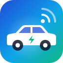

<div align="center">



# bluelink-mcp

**Talk to your Hyundai or Kia.**

An open-source [Model Context Protocol](https://modelcontextprotocol.io) server for **Hyundai Bluelink** and **Kia Connect** (formerly UVO). It lets Claude and other AI assistants check your car's charge, fuel, range, locks and location, and, if you allow it, pre-heat the cabin, lock the doors or start charging.

[](https://github.com/mattoddie/bluelink-mcp/actions/workflows/ci.yml)
[](https://github.com/mattoddie/bluelink-mcp/releases)
[](https://github.com/mattoddie/bluelink-mcp/pkgs/container/bluelink-mcp)
[](LICENSE)

**[bluelink-mcp.mattoddie.dev](https://bluelink-mcp.mattoddie.dev)**

[Quick start](#quick-start) · [Documentation](https://bluelink-mcp.mattoddie.dev/docs/) · [Tool reference](docs/tools.md) · [Contributing](CONTRIBUTING.md)

</div>

---

It's built on [`hyundai_kia_connect_api`](https://github.com/Hyundai-Kia-Connect/hyundai_kia_connect_api), the library behind the Home Assistant Kia/Hyundai integration. Hyundai and Kia work in most regions, and Genesis in some; see [Compatibility](docs/compatibility.md). The name and settings say Bluelink (`BLUELINK_*`), but they cover Kia Connect too: for a Kia, set `BLUELINK_BRAND=kia`.

> **"Is the car charged, and is it locked?"**
> *The Santa Fe is at 80% (about 52 km of electric range, 610 km total with fuel) and finished charging at 06:10. All doors are locked and the windows are closed. Bluelink last heard from it 25 minutes ago.*

> **"Warm the EV6 up for 15 minutes."**
> *Done. The Kia confirmed it, so the cabin is heating to 21 °C for 15 minutes. It's at 64%, so there's plenty of charge for that.*

> [!NOTE]
> This is an unofficial project and isn't affiliated with Hyundai, Kia or Genesis. Their APIs are undocumented and change without notice.

## Tools

| Tool | What it does | Needs |
| --- | --- | --- |
| `list_vehicles` | Vehicles on the account | |
| `get_vehicle_status` | Last reported battery/fuel, range, charging, climate, locks, doors, windows, tyres, warnings and charging schedule. Doesn't wake the car. | |
| `refresh_vehicle_status` | Wakes the car for live data. Rate limited (see below). | |
| `get_vehicle_location` | Latitude/longitude, map link and optional address | |
| `get_trips` | A day's trips, or a month's summary | |
| `get_energy_usage` | Daily energy use for driving, climate, electronics and battery care | |
| `get_command_status` | Result of an earlier command | |
| `lock_vehicle` | Lock the doors | writes |
| `start_climate` / `stop_climate` | Pre-condition the cabin: temperature, duration, defrost, heated rear window/mirrors and steering wheel, seats | writes |
| `start_charging` / `stop_charging` | Start or stop charging | writes |
| `set_charge_limits` | AC/DC charge limits (EVs; most plug-in hybrids don't support this) | writes |
| `flash_hazard_lights` | Flash the hazards to find the car | writes |
| `unlock_vehicle` | Unlock the doors | writes + unlock |

Every tool takes an optional `vehicle` (name, VIN or ID). You can leave it out if the account has one car.

## Quick start

You need a Hyundai Bluelink or Kia Connect account that works in the app, and [uv](https://docs.astral.sh/uv/) or Docker. The defaults are for a Hyundai in Europe. For a Kia, add `BLUELINK_BRAND=kia`, and outside Europe set `BLUELINK_REGION`.

### Claude Code with uv (stdio)

```sh
git clone https://github.com/mattoddie/bluelink-mcp && cd bluelink-mcp
claude mcp add bluelink \
  -e BLUELINK_USERNAME=you@example.com \
  -e BLUELINK_PASSWORD='your-password' \
  -e BLUELINK_PIN=1234 \
  -e BLUELINK_ALLOW_WRITES=true \
  -- uv run --directory "$PWD" bluelink-mcp
```

For a Kia, add `-e BLUELINK_BRAND=kia`. Claude Desktop and other clients use the same command (`uv run --directory /path/to/bluelink-mcp bluelink-mcp`) with the same environment variables.

### Docker (Streamable HTTP)

```sh
cp example.env .env   # fill in BLUELINK_* (BLUELINK_BRAND=kia for a Kia) and a random MCP_AUTH_TOKEN (openssl rand -hex 32)
docker compose up -d
claude mcp add --transport http bluelink http://<docker-host>:8080/mcp \
  --header "Authorization: Bearer <MCP_AUTH_TOKEN>"
```

Then ask *"How's the car doing?"*

## Configuration

All settings are environment variables; [`example.env`](example.env) lists and explains them.

| Variable | Default | |
| --- | --- | --- |
| `BLUELINK_USERNAME`, `BLUELINK_PASSWORD` | | Your Bluelink or Kia Connect app login (required) |
| `BLUELINK_PIN` | | Your app PIN. Europe needs it for remote commands. |
| `BLUELINK_REGION` | `europe` | `europe`, `europe-cci`, `usa`, `canada`, `australia`, `nz`, `india`, `china`, `brazil` |
| `BLUELINK_BRAND` | `hyundai` | `hyundai` (Bluelink), `kia` (Kia Connect / UVO), `genesis` (Genesis Connect) |
| `BLUELINK_LANGUAGE` | `en` | Response language (Europe) |
| `BLUELINK_GEOCODE` | `false` | Add a street address to the location via OpenStreetMap |
| `BLUELINK_ALLOW_WRITES` | `false` | Register the command tools |
| `BLUELINK_ALLOW_UNLOCK` | `false` | Also register `unlock_vehicle` (needs writes) |
| `BLUELINK_MIN_REFRESH_MINUTES` | `10` | Minimum gap between `refresh_vehicle_status` calls per car |
| `BLUELINK_CACHE_SECONDS` | `60` | How long a status read is reused |
| `BLUELINK_LOGIN_RETRY_MINUTES` | `5` | Wait after a failed login before trying again |
| `BLUELINK_TOKEN_FILE` | `~/.local/state/bluelink-mcp/token.json` (`/data/token.json` in Docker) | Login token cache. Set it empty to turn caching off. |
| `MCP_TRANSPORT` | `stdio` (`http` in Docker) | `stdio` or `http` |
| `MCP_HTTP_HOST`, `MCP_HTTP_PORT` | `127.0.0.1`, `8080` | HTTP listen address |
| `MCP_AUTH_TOKEN` | | Bearer token clients must send. Required for `http`. |
| `MCP_ALLOWED_HOSTS` | | Optional Host header allow-list for DNS rebinding protection |
| `MCP_ALLOWED_ORIGINS` | | Origins browser-based clients may use, when `MCP_ALLOWED_HOSTS` is set |

### Which region and brand?

In the UK and the rest of Europe, start with `europe`, the classic Bluelink and Kia Connect Europe service. Some newer Hyundais and Kias use the CCI/"OneApp" backend instead. If login or status fails with `europe`, try `europe-cci`.

Not every brand is available everywhere. New Zealand is Kia only, Brazil is Hyundai only, and Genesis doesn't work with `europe-cci`. See the [compatibility table](docs/compatibility.md#regions-and-brands).

## Being kind to your car (and your account)

- **Reads come from Bluelink, not the car.** `get_vehicle_status` returns what the car last uploaded, which happens when it is switched off, while charging and after commands. Check `last_updated_at`.
- **Waking the car costs something.** `refresh_vehicle_status` makes the car's modem report in. Done often, this drains the 12V battery, and Hyundai and Kia limit API calls per day in Europe. It is rate limited per car (`BLUELINK_MIN_REFRESH_MINUTES`).
- **Logins are cached.** Repeated password logins can get an account temporarily blocked, so the server keeps the token in `BLUELINK_TOKEN_FILE` (mode `0600`). The file contains your session tokens, password and PIN, so treat it like a password. After a failed login the server discards the cache and waits `BLUELINK_LOGIN_RETRY_MINUTES` before trying again.
- **Commands are slow.** They travel over the mobile network and usually take 20–60 s. With `wait=true` (the default), the tool waits up to about 60 s for the car to confirm, then returns `pending` with an `action_id` to check later; other tools keep working meanwhile. `timeout` means the car didn't answer, not necessarily that nothing happened.

## Safety

The server is read-only unless you set `BLUELINK_ALLOW_WRITES=true`, and `unlock_vehicle` needs its own `BLUELINK_ALLOW_UNLOCK=true` switch. Tools carry MCP annotations (read-only, destructive) so clients can ask before running them. In HTTP mode every request needs the bearer token, so don't expose the port to the internet without TLS in front of it.

## Documentation

| | |
|---|---|
| [Getting started](docs/getting-started.md) | From nothing to your first question |
| [Connecting MCP clients](docs/clients.md) | Claude Code, Claude Desktop, VS Code, Cursor, Codex, stdio |
| [Configuration](docs/configuration.md) | Every setting, and choosing a region and brand |
| [Using bluelink-mcp](docs/usage.md) | Example questions, cached vs live data, commands |
| [Tool reference](docs/tools.md) | Every tool and argument |
| [Security](docs/security.md) · [Deployment](docs/deployment.md) · [Troubleshooting](docs/troubleshooting.md) | Running it well |

## Development

```sh
uv sync
uv run pytest
uv run ruff check . && uv run ruff format --check .
```

The tests use a fake vehicle manager, so they need no car account or network. See [Development](docs/development.md) and the [contributing guide](CONTRIBUTING.md).

## License

[MIT](LICENSE)
